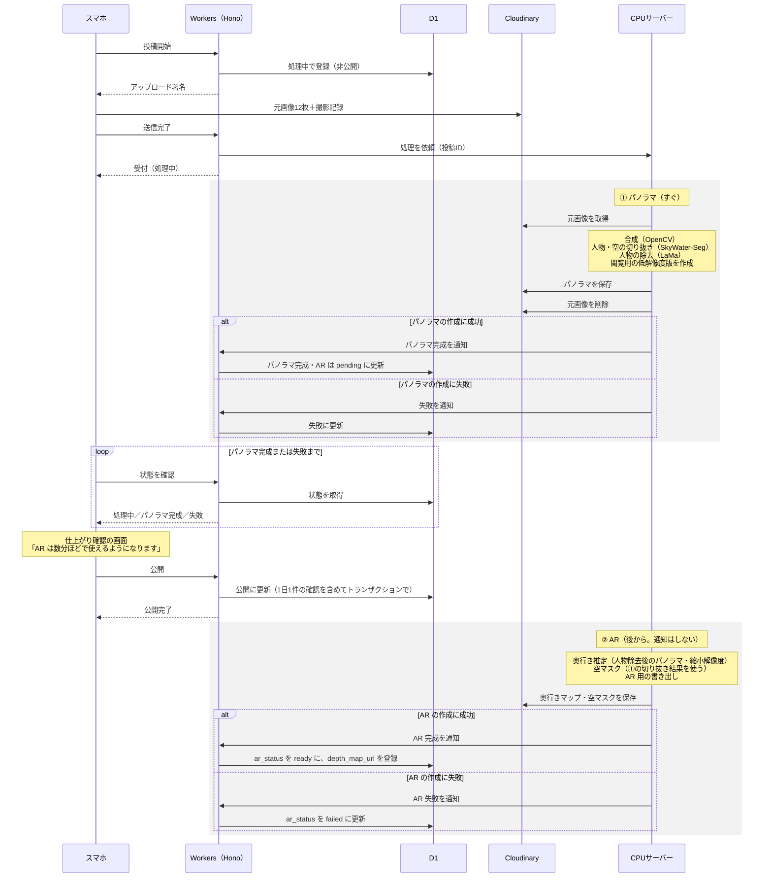
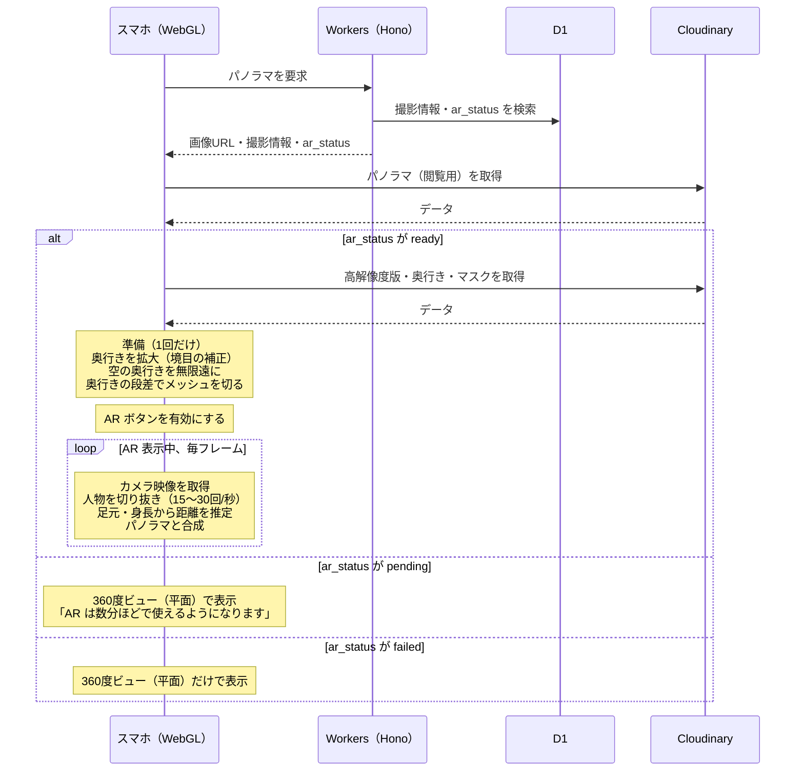

# 人物合成モード シーケンス図

作成日：2026-10-15（同日更新：パノラマと AR の 2 段階生成に変更）
関連資料：[人物合成モード 実装方針](person_composite_mode.md)

## 役割分担

- **AI のモデルを動かす処理**：投稿時の CPU サーバー
  - ① パノラマ（すぐ）：合成・人物の切り抜き・人物の除去
  - ② AR（後から）：奥行き推定・空マスク
- **シェーダーでできる仕上げ**：閲覧時の WebGL（1回だけ）
- **毎フレーム必要な処理**：スマホでの人物の切り抜き・距離の推定・合成

## 生成の方針

- パノラマを先に作って投稿者に返し、AR は後から作る。
- 投稿時に「AR は数分ほどで使えるようになります」と表示し、**AR の完成は通知しない**。
- AR の状態は、パノラマの画面で表示する（準備中／利用できる／利用できない）。
- AR の生成に失敗しても、パノラマは 360度ビュー（平面）で見られる。撮り直しは不要。
- **人が写ったまま公開しないよう、人物の除去はパノラマの段階で必ず行う。**

### AR の状態（`panoramas.ar_status`）

| 値 | 意味 | 画面の表示 |
| --- | --- | --- |
| `pending` | 生成中 | 「AR は数分ほどで使えるようになります」。AR ボタンは押せない |
| `ready` | 生成済み | AR ボタンを有効にする。`depth_map_url` などが入っている |
| `failed` | 生成に失敗 | 360度ビュー（平面）だけで表示する。`depth_map_url` は空 |

## 1. 投稿時

スマホは画像を直接 Cloudinary に送り、Workers は受付・登録・依頼だけを担当する。CPU サーバーは ① パノラマを作って知らせたあと、続けて ② AR を作る。

## 2. 閲覧時

サーバーの処理は入らない。スマホが保存済みのデータを受け取り、AR の状態に応じて表示を切り替える。

## 補足

- 投稿時の「状態を確認」は、一定間隔で問い合わせる方式を想定している。待つのはパノラマの完成までで、AR の完成は待たない。
- ① パノラマの処理時間は実測して、「すぐ」と言える範囲（例：1分以内）に収まるか確認する。収まらない場合は、①では顔ぼかしだけにして、②で人物除去版に差し替える。
- 「数分ほど」の目安は、実測した ② の処理時間に余裕を足して決める。処理が重なると待ち時間が延びるので、幅を持たせた書き方にする。
- 人が写った元画像は、① のパノラマを保存した直後に Cloudinary から削除する（② は人物除去後のパノラマを使うので、元画像は不要）。
- CPU サーバーの処理は、同じ投稿を2回処理しても結果が壊れないように作る（保存先を投稿 ID で固定する）。
- 1日1件の数え方は、公開した時点で数える案にしている。失敗した投稿は数えないので、その日のうちに撮り直せる。
- 投稿者が AR の出来を確認しないまま公開されるため、投稿者がマイページで AR の状態と見た目を確認できるようにするか、閲覧者が「表示がおかしい」と報告できるようにすることを検討する。
- D1 では `panoramas` に `ar_status` を追加し、AR が完成するまで `depth_map_url` を空にしておく。